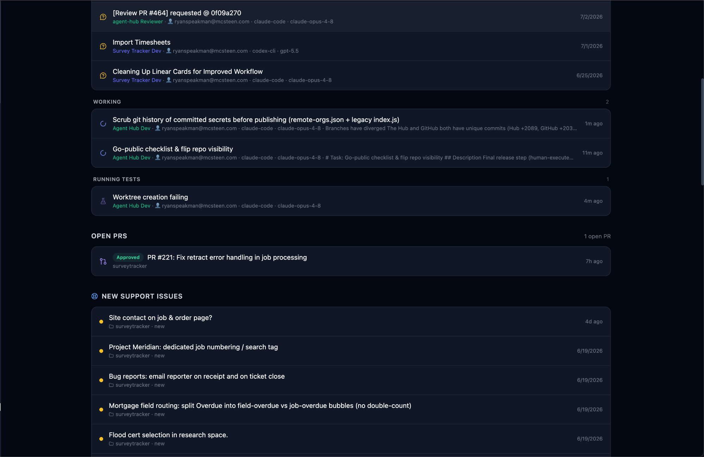
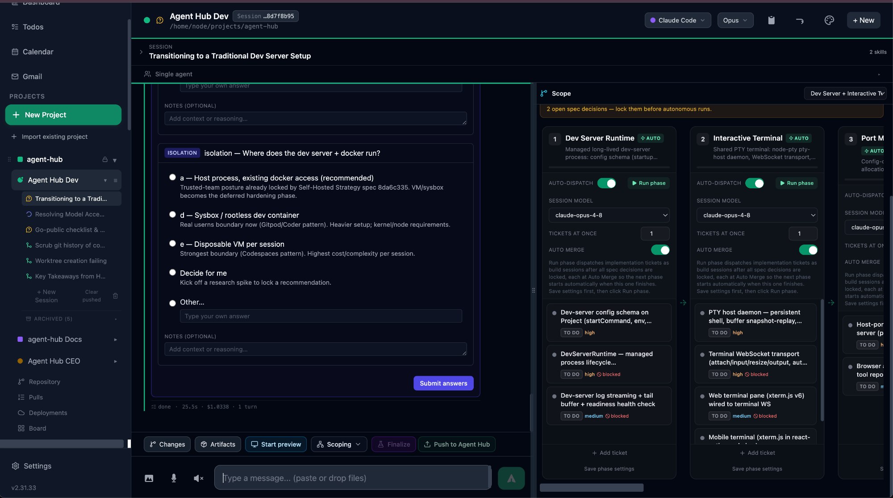
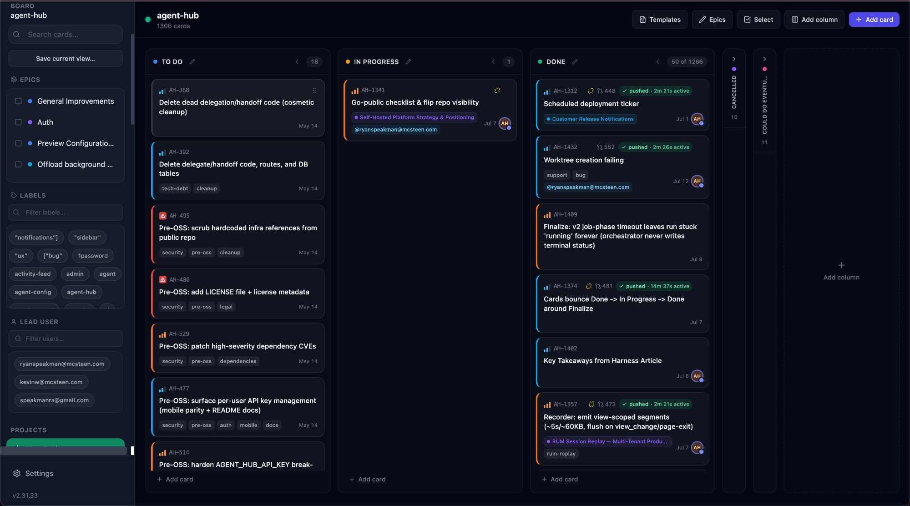
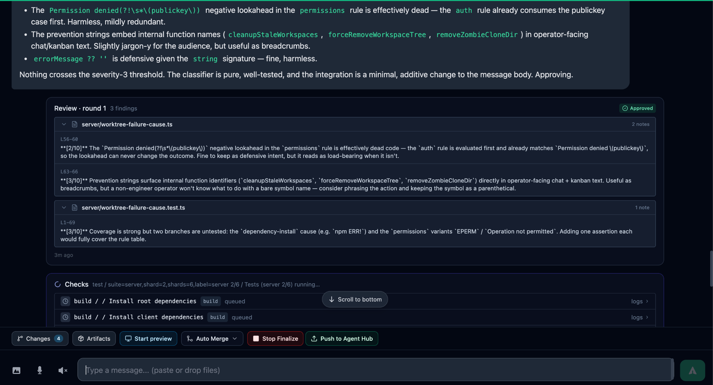
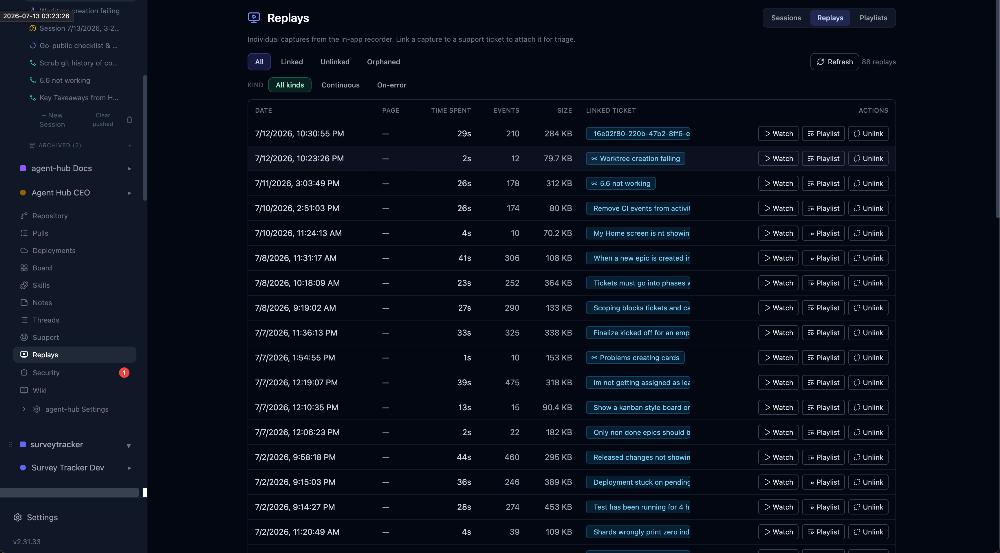
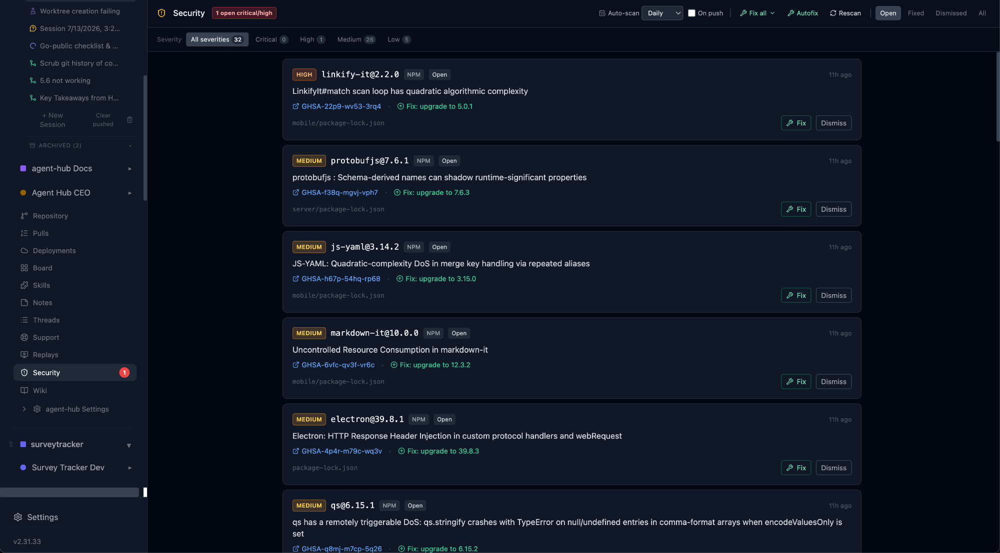
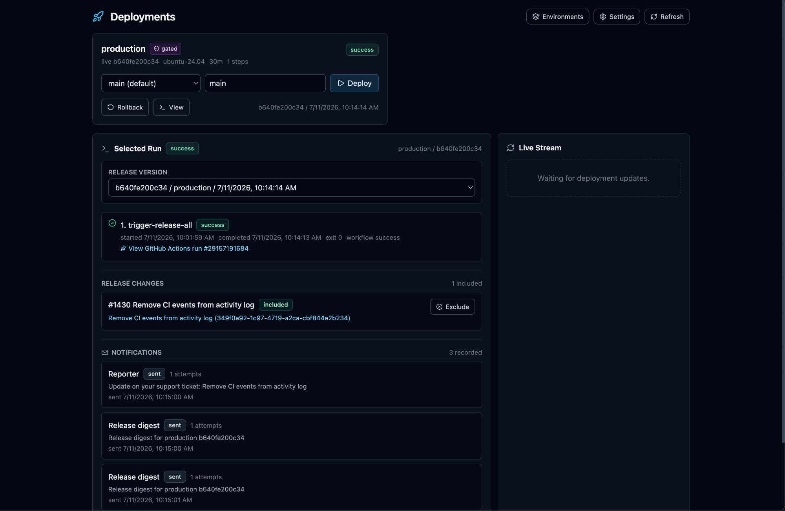
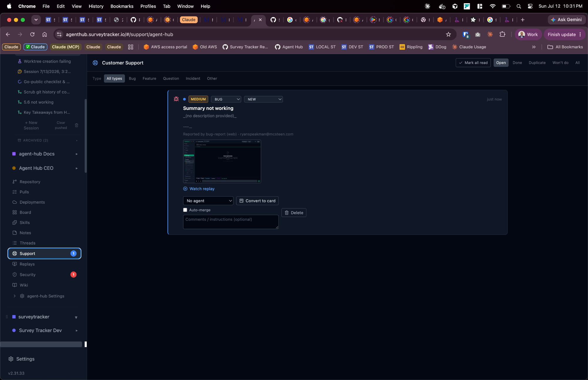
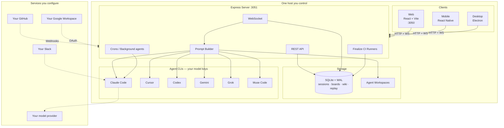
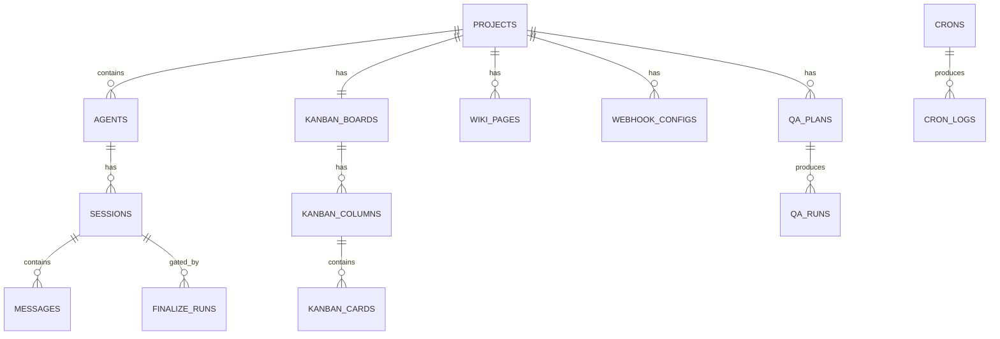

# Agent Hub

**A self-hosted home base for AI coding agents.** Agent Hub runs on your own
machine or server and gives your agents (Claude Code, Cursor, Codex, Gemini,
Grok, Muse Code) a real workspace: chat, a kanban board, a wiki, git hosting
and code review, CI gating, QA, deployments, and session replay, all in one app
on hardware you control.

Think of it as the dashboard your agents work _inside_, instead of a chat box
bolted onto your editor.

[](LICENSE)




> **Not an AI coding assistant.** Assistants live in someone else's cloud and
> autocomplete inside your editor. Agent Hub is the **self-hosted DevSecOps platform** the assistant runs _inside_.
> **Your entire SDLC runs in your VPC and never phones home.** You bring your own model keys (BYO-inference), so your code and prompts never leave your network.

---

## What is Agent Hub?

You already have AI coding tools. Agent Hub is the place they live and
collaborate. You create a **project** (usually a git repo), add one or more
**agents** to it, and then talk to them, assign them work, and watch them ship —
from a browser, a phone, or a desktop app.

Everything runs on **one Node process backed by a local SQLite file**. There's
no cloud account, no external database, and nothing phones home. You bring your
own model keys, so your prompts and code go straight from your box to your model
provider and nowhere else.

Two ways to run it (both fully self-hosted):

- **Local** — run it on your own laptop or desktop for yourself. One command,
  open a browser tab, done.
- **Self-hosted server** — run it on a home server, VPS, or cloud VM so you (and
  your team) can reach it from any device on the network.

Same app either way. The only difference is where the server process lives.

---

## What it does

Each project gets its own set of tools. Here's the tour.

### Chat with your agents

Talk to any agent over a live, streaming connection. Pick the engine and model,
attach files or dictate by voice, and the agent answers with the context of your
project: its code, wiki, and memory. Agents can ask _you_ structured questions,
request a secret through a masked input card (never stored in the transcript),
and pause for your approval before anything irreversible.

Each session runs in its own git worktree on its own branch, and has a **mode**
that sets what it's for: normal build chat, Consult (read-only), Scoping,
Design, QA, Skill Builder, an isolated experiment you can discard, or Autopilot.
Side panes show the session's live dev preview, changed files, artifacts,
background shells, context usage, and a quick side-question thread.



### Kanban board

Every project has a board with epics, labels, priorities, blockers, and card
templates. Assign a card to an agent and it picks the work up on its own
(**autonomous dispatch**), opens a session branch, and reports back. Turn on
**Autopilot** for an epic and the Hub dispatches its cards in order, unsticks
stalled turns, and lands the results. It's issue tracking and task dispatch in
one place.



### Finalize Code Changes (built-in CI gate)

Before any agent's work gets pushed, **Finalize** rebases the branch, runs an
in-hub review, and runs your `.agent-hub/ci.yaml` checks on an isolated
Docker-in-Docker runner capped to match a GitHub-hosted runner. Failing checks
send a fix turn back to the agent automatically. Each session picks an
automation level (Manual, Review, Push, or Merge) that decides how far Finalize
goes on its own. Runners can live on the Hub host or on an autoscaling EC2 fleet.



### Git hosting and pull requests

Agent Hub can host a project's git repository itself, with a GitHub-style code
browser, native pull requests, inline review comments, and an optional mirror to
GitHub. The project's Reviewer agent leaves formal reviews; you can open a
**Discuss** session on any PR, retarget it, update its branch, schedule an
auto-merge, or have the Hub resolve a failing PR. GitHub-hosted projects keep
working through webhooks and the GitHub App.

### QA agent

Every project gets a seeded QA agent. You draft a QA plan with it (ordered test
cases against a target URL or the session preview), approve it, and run it. Each
case gets a screenshot and a verdict; failures become cards assigned to the dev
agent, and plans can rerun automatically once the fix merges. A human signs off
when the latest run passes.

### Previews and PR environments

Start a live dev preview for any session and watch it hot-reload as the agent
edits. Agents drive the preview in a pinned Chromium to check their own work.
Per-PR environments boot a full stack from the `preview:` block in
`deploy.yaml`, with share links, wake-on-request, and cost controls. iOS apps
can get per-PR preview builds too.

### Session replay (RUM)

Agent Hub can record real user sessions of your app with
[rrweb](https://github.com/rrweb-io/rrweb) and flag frustration signals (rage
clicks, dead clicks, error clicks). Watch a replay, link it to a ticket — a
self-hosted alternative to LogRocket or FullStory.



### Security scanning

Per-commit **secret scanning** checks every commit for leaked credentials and
other findings, with a configurable ignore list so you're not drowning in noise.
A Dependabot-style **dependency audit** scans Hub-hosted repos against OSV and
files cards for vulnerable packages.



### Deployments

Define your environments in a `deploy.yaml` and ship from the app: pick a
branch, hit deploy, watch the live stream, and roll back if needed. Environments
support release gates, schedules, triggers, scoped secrets, and per-environment
notification routing. Release digests can be regenerated, edited, and resent.
The same file's `preview:` block declares what a per-PR environment boots. See
[`docs/guides/deploy-yaml.md`](docs/guides/deploy-yaml.md).



### Customer support queue

Take in support tickets per project (with attachments and an in-app bug-report
button that captures a replay), order them by severity, watch the attached
session replay, and convert a ticket into a kanban card with one click.

### Logs and infrastructure

Ship application logs over OTLP and Agent Hub groups errors into issues, links
them by request ID, and charts log metrics. Point a project at an AWS account to
monitor resources, see Cost Explorer spend trends, receive AWS Health events,
and route infra alerts.

### Hub Chat, inbox, and your day

Outside of projects, the **Hub** is a team workspace:

- **Chat** channels and DMs with mentions, reactions, pins, full-text search,
  and agent channels where an `@mention` dispatches the agent. Channels can run
  scheduled AI digests and post project event triggers.
- **Inbox** notifications with per-user preferences, plus desktop and mobile
  push.
- **Google Workspace** (multiple accounts): Gmail with AI importance scanning,
  Calendar agenda and month view, Google Chat, Drive, and Sheets, all reachable
  by agents through a server-side proxy.
- **Todos, reminders, and notes**, including voice notes with transcription and
  summaries.



### And the rest

- **Wiki**: a per-project knowledge base with full-text search and folder
  document uploads. It's injected into agent context, and a docs agent keeps
  it current as work merges.
- **Agent browser and desktops**: agents drive a real Chromium (and, where
  configured, a persistent Linux desktop) that you watch live and can take over.
  They can sign in with your credentials or hand the page to you; saved browser
  profiles are encrypted at rest.
- **Design Studio**: a session mode where the agent builds HTML/CSS/JS mockups
  that render live beside the chat.
- **Skills**: project and global skills, a Skill Builder session mode with eval runs,
  and routines drafted from a recorded browser demo.
- **Background agents and crons**: project-scoped scheduled jobs and custom
  background agents.
- **Stats**: per-project charts for PRs merged, tickets, epics, model usage, and
  time to ship.
- **Organizations**: multi-user orgs with Owner/Admin/User roles, MFA, invites,
  and per-user engine sign-in.
- **Slack**: a multi-agent Slack bot for talking to agents from your chat tool.
- **Cross-platform clients**: web, mobile (React Native / Expo), and desktop
  (Electron), all with the same features.

### One platform, not five subscriptions

Because it's all in one app, Agent Hub displaces a stack of separate SaaS
products — one bill, one data boundary, one place to look:

| Instead of…                         | Agent Hub gives you                     |
| ----------------------------------- | --------------------------------------- |
| Jira / Linear / GitHub Projects     | Kanban boards with autonomous dispatch  |
| GitHub / GitLab hosting and PRs     | Hosted git with native pull requests    |
| CircleCI / GitHub Actions minutes   | Finalize Code Changes CI gating         |
| Manual QA passes / test-case tools  | QA agent with approved plans and runs   |
| LogRocket / FullStory / Datadog RUM | Session replay with frustration signals |
| Vercel / Netlify preview seats      | Per-PR preview environments             |
| Confluence / Notion                 | Per-project wiki with full-text search  |
| Standalone secret scanners          | Per-commit secret scanning              |
| Log search / error tracking         | OTLP log ingest grouped into issues     |

And because the same agents can author the config, an agent stands the platform up for itself:
point it at your repo and guided setup skills write the `ci.yaml`, `deploy.yaml`, dev-server
preview config, log shipping, session-replay recorder, and AWS monitoring.

---

## Quick start (run it locally)

```bash
# Clone the repo
git clone https://github.com/Speakman-ai/agent-hub.git
cd agent-hub

# Use the pinned Node version (reads .nvmrc)
nvm use

# Install everything (root, server, shared, client, mobile)
npm run install:all

# Start the client + server together
npm run dev
```

Open **[http://localhost:3050](http://localhost:3050)** in your browser. The API
server runs on port 3051. On first launch you'll complete a short
**`/api/auth/setup`** flow to create the first account. `npm run dev:local`
skips login with a single-user bypass, the same mode the desktop app uses.

There are **no required environment variables and no external services** —
SQLite is local and search is built in. Add at least one
[engine CLI](#engine-clis) and its model key and you have a working setup.

### Prerequisites

- **Node.js** `>=22.14.0 <23.0.0` — pinned in `.nvmrc` (run `nvm use`). The
  version is tied to Electron's bundled Node so `better-sqlite3` builds the same
  in dev and packaged apps.
- **npm** (ships with Node).
- **A C build toolchain** for `better-sqlite3`'s native module:
  - Linux: `sudo apt install build-essential python3`
  - macOS: `xcode-select --install`
  - Windows: [Visual Studio Build Tools](https://aka.ms/vs/17/release/vs_BuildTools.exe)
    with the "Desktop development with C++" workload, or re-run the
    [Node.js installer](https://nodejs.org/) and tick "Automatically install the
    necessary tools".
- **At least one engine CLI** (below). The server boots without one, but chat
  sessions can't run until a CLI is on `PATH` or pointed at in config.
- **`gh` CLI** (optional) — only for GitHub webhook helpers and autonomous PR
  review.

### Engine CLIs

Agent Hub drives third-party agent CLIs — it doesn't ship them and never proxies
your prompts. You bring the binary and the key; model traffic goes straight from
your box to your provider.

| Engine       | Get it                                                              | Auto-installer                        | Notes                                                    |
| ------------ | ------------------------------------------------------------------- | ------------------------------------- | -------------------------------------------------------- |
| Claude Code  | [claude.ai/code](https://claude.ai/code) — Anthropic Pro/Max or API | _none_ — install per Anthropic's docs | Paid third-party account required.                       |
| Cursor Agent | [cursor.com/install](https://cursor.com/install)                    | `bash scripts/ensure-cursor-agent.sh` | Symlinks to `~/.local/bin/agent`, the server's default.  |
| Codex        | `@openai/codex` (npm)                                               | `bash scripts/ensure-codex.sh`        | Symlinks `codex` into `~/.local/bin`.                    |
| Gemini CLI   | Google's official installer                                         | _none_                                | Point `geminiBin` at it.                                 |
| Grok Build   | [x.ai/cli](https://x.ai/cli)                                        | `bash scripts/ensure-grok.sh`         | Symlinks to `~/.local/bin/grok`. Auth via `XAI_API_KEY`. |
| Muse Code    | Meta's official installer                                           | _none_                                | Defaults to `~/.local/bin/muse`. Point `museBin` at it.  |

Once a binary is on disk, the Hub finds it three ways (in priority order): an
**env var** (`CLAUDE_BIN` / `CURSOR_BIN` / `GEMINI_BIN` / `CODEX_BIN` /
`GROK_BIN` / `MUSE_BIN`) → **`~/.agent-hub/data/config.json`** (`claudeBin`,
etc.) → a **smart PATH probe** across common install locations. You can also set
every path from **Settings → Engines** in the UI, no JSON editing required.

On a shared server each user signs in to the engines with their own account
(browser sign-in or device code) from their personal settings, so spawned
sessions run under that user's subscription or key.

---

## Run it on a server (self-hosted)

Agent Hub is a **server-first app with an optional desktop client** — a bit like
Plex or Home Assistant. Three supported ways to run it, all self-hosted:

| Mode                              | What you run                                                              | Best for                                                       |
| --------------------------------- | ------------------------------------------------------------------------- | -------------------------------------------------------------- |
| **Server + browser**              | `npm run dev` (or PM2) on a Linux box, reached from any device on the LAN | You have a home server / VPS and want zero install on clients. |
| **Server + Electron remote**      | The same server, plus the Electron app pointed at it                      | A native window/tray on your laptop, no port-forward juggling. |
| **All-in-one Electron (`local`)** | The packaged Electron app — boots its own server in-process               | Single-machine use on a Mac.                                   |

### Server + browser

Run the server on any host other devices can reach, then point a browser at it.

```bash
# On the server
git clone https://github.com/Speakman-ai/agent-hub.git
cd agent-hub && nvm use && npm run install:all

# Option A — full dev stack (Vite UI on :3050, API on :3051).
# Set ALLOWED_ORIGINS to the URL the browser loads (the Vite port).
ALLOWED_ORIGINS=http://linux-box.local:3050 npm run dev

# Option B — production-style: build the client once, serve everything
# from the API server on a single port (:3051).
npm run build
ALLOWED_ORIGINS=http://linux-box.local:3051 npm run dev:server
```

**Pick a port and match it.** `npm run dev:server` only serves the client on
`:3051` if `client/dist/index.html` exists (created by `npm run build`);
otherwise `:3051` in a browser 404s. So either run `npm run dev` and use `:3050`,
or `npm run build` first and use `:3051`.

**CORS matters here.** Browser requests are gated by an allowlist in
`server/cors-config.ts`. If `ALLOWED_ORIGINS` doesn't match the origin you load
the page from, the browser blocks the API responses. Comma-separate multiple
origins. Requests with no `Origin` header (Electron, mobile, curl,
server-to-server) skip CORS entirely. For SSH port-forward
(`ssh -L 3050:localhost:3050 host`), use `ALLOWED_ORIGINS=http://localhost:3050`.

### Server + Electron remote client

Run the server as above, then install the Electron app on each desktop and point
it at the hub. `electron/main.ts` reads a `connConfig` and branches on `mode`:

- `local` — fork the bundled server in-process, load `http://localhost:<port>`.
- `remote` — load `connConfig.remoteUrl`, inject auth headers (`x-api-key`, JWT)
  on matching hosts. No server spawned on the client.
- `dev` — load the Vite dev client at `localhost:3050`.

`remote-orgs.json` under `app.getPath('userData')` lets you register and switch
between multiple remote hubs; the login screen offers the saved servers. Electron remote mode ignores `ALLOWED_ORIGINS`
because Electron sends no `Origin` header.

### All-in-one Electron

The packaged Electron app boots the same Express server in-process, so there's no
separate server to run. Each release builds macOS DMGs (Apple Silicon and
Intel), and a running hub shows a desktop update card with the download for your
Mac. Linux and Windows installers aren't published yet. To build one yourself:

```bash
npm run electron:build      # macOS DMG (host arch only)
npm run electron:pack       # --dir output for a local smoke-test
npm run release:mac         # macOS DMGs (arm64 + Intel)
```

---

## Configuration

The primary config file is `~/.agent-hub/data/config.json`. A legacy
`server/config.json` still works as a fallback, but new installs should write to
the data dir:

```json
{
  "port": 3051,
  "claudeBin": "/usr/local/bin/claude",
  "cursorBin": "/usr/local/bin/agent",
  "geminiBin": "/usr/local/bin/gemini",
  "codexBin": "/usr/local/bin/codex",
  "grokBin": "/usr/local/bin/grok",
  "museBin": "/usr/local/bin/muse",
  "defaultCwd": "/home/youruser",
  "apiKey": null,
  "publicUrl": null
}
```

You can edit every CLI path from **Settings → Engines** in the UI. Config
resolves in priority order: **env vars** > **`~/.agent-hub/data/config.json`** >
**`server/config.json` (legacy)** > **built-in defaults**.

| Environment Variable    | config.json Key | Default                                       | Description                                                        |
| ----------------------- | --------------- | --------------------------------------------- | ------------------------------------------------------------------ |
| `AGENT_HUB_PORT`        | `port`          | `3051`                                        | Server port                                                        |
| `AGENT_HUB_HOST`        | `host`          | `0.0.0.0`                                     | Bind address (all interfaces; set `127.0.0.1` for loopback only)   |
| `AGENT_HUB_DATA_DIR`    | `dataDir`       | `~/.agent-hub/data`                           | SQLite + workspaces root                                           |
| `CLAUDE_BIN`            | `claudeBin`     | _smart probe_                                 | Path to Claude Code CLI                                            |
| `CURSOR_BIN`            | `cursorBin`     | `~/.local/bin/agent`                          | Path to Cursor Agent CLI                                           |
| `GEMINI_BIN`            | `geminiBin`     | _smart probe_                                 | Path to Gemini CLI                                                 |
| `CODEX_BIN`             | `codexBin`      | `~/.local/bin/codex`                          | Path to Codex CLI                                                  |
| `GROK_BIN`              | `grokBin`       | `~/.local/bin/grok`                           | Path to Grok Build CLI                                             |
| `MUSE_BIN`              | `museBin`       | `~/.local/bin/muse`                           | Path to Muse Code CLI                                              |
| `AGENT_HUB_DEFAULT_CWD` | `defaultCwd`    | `$HOME`                                       | Fallback working directory                                         |
| `AGENT_HUB_API_KEY`     | `apiKey`        | `null`                                        | Break-glass API key (treated as Owner for all orgs)                |
| `AGENT_HUB_PUBLIC_URL`  | `publicUrl`     | `null`                                        | Public URL for webhooks, OAuth callbacks, spawn fallback           |
| `AGENT_HUB_AGENT_URL`   | `agentHubUrl`   | loopback                                      | API base injected into spawned CLIs when they can't reach loopback |
| `ALLOWED_ORIGINS`       | —               | `http://localhost:3050,http://127.0.0.1:3050` | Comma-separated browser CORS allowlist                             |

> **Bind-address note:** the server binds to `0.0.0.0` by default, so on a LAN
> box the API is reachable on every interface. That's right for the server modes,
> but on a shared host where only the local UI should reach the API, set
> `AGENT_HUB_HOST=127.0.0.1`.

The agent browser trusts the exact origin of `publicUrl` (or
`AGENT_HUB_PUBLIC_URL`), including a private LAN address. For example, a Hub
configured as `http://192.168.50.45` can be opened by agents and through the
Agent browser address bar. Trust covers that scheme, host, and port across all
paths; it does not grant access to other private addresses or ports. Authentication
still applies. Session previews remain pinned to their own origin. An unset or
invalid public URL grants no private-network exception.

---

## How it fits together

Agent Hub follows a **control-plane / data-plane split**: everything that
touches your code, prompts, and recordings runs inside your VPC (the data
plane). The only piece a vendor could ever host is optional licensing/updates —
never in the path of your data.



Nothing crosses your network boundary unless you wire it there. The dashed edges
are your own integrations — remove them and the app still runs, fully offline.

### Tech stack

| Layer          | Technology                                                                      |
| -------------- | ------------------------------------------------------------------------------- |
| Server         | Node.js, Express, ES Modules, TypeScript (strict)                               |
| Database       | SQLite ([better-sqlite3](https://github.com/WiseLibs/better-sqlite3)), WAL mode |
| Real-time      | [ws](https://github.com/websockets/ws) (WebSocket)                              |
| Web client     | React 18, Vite, Tailwind CSS                                                    |
| Mobile         | React Native, Expo                                                              |
| Desktop        | Electron                                                                        |
| CI runners     | Docker-in-Docker (GitHub-parity resource caps)                                  |
| Session replay | rrweb                                                                           |
| Browser        | Playwright Chromium (agent browser, previews, QA)                               |
| Scheduling     | node-cron                                                                       |
| Slack          | @slack/bolt                                                                     |
| Testing        | Vitest, supertest, Playwright                                                   |
| Deployment     | Self-hosted — Nginx, PM2 (EC2/Terraform reference module included)              |

---

## Core concepts

### Projects and agents

**Projects** are the top-level unit. Each has a working directory (`cwd`), an
Agent Hub workspace (`ahw`) for context files, and a color. **Agents** belong to
a project and each has its own engine, model, and custom instructions. Every
project is seeded with a QA agent, and projects with a review surface (GitHub or
Hub-hosted git) also get a Reviewer agent. The model is flat: agents coordinate through plain chat or multi-agent
sessions, and the engine CLIs handle their own internal sub-agents.

### Enriched prompts

Before every agent run, the server builds a prompt from the agent's config +
workspace context files (`AGENTS.md`, `SOUL.md`, `MEMORY.md`, …) + matching
skills + wiki summaries + daily memory notes. Agents get persistent project
knowledge without you managing conversation history by hand.

| File          | Purpose                                              |
| ------------- | ---------------------------------------------------- |
| `AGENTS.md`   | Agent role definitions and team structure            |
| `SOUL.md`     | Personality, behavioral guidelines, coding standards |
| `IDENTITY.md` | Identity and background context                      |
| `USER.md`     | User preferences and context                         |
| `TOOLS.md`    | Available tools and usage instructions               |
| `MEMORY.md`   | Persistent memory across sessions                    |

### Real-time updates

A REST endpoint performs a mutation, the server broadcasts a WebSocket event
(`{ type: 'feature_action', projectId, ...data }`), and every connected client
refetches. That's how boards, chats, and the wiki stay live across devices.

---

## API overview

The server exposes a REST API at `http://localhost:3051/api`:

| Resource | Endpoints                                  | Description                             |
| -------- | ------------------------------------------ | --------------------------------------- |
| Projects | `/api/projects`                            | CRUD for projects and their agents      |
| Sessions | `/api/sessions`                            | Chat session management                 |
| Messages | `/api/sessions/:id/messages`               | Message history                         |
| Kanban   | `/api/projects/:id/board`                  | Boards, columns, cards, epics, comments |
| Wiki     | `/api/projects/:id/wiki`                   | Knowledge base with full-text search    |
| Pulls    | `/api/projects/:id/pulls`                  | Native pull requests on hosted repos    |
| QA       | `/api/projects/:id/qa/plans`               | QA plans, runs, and verdicts            |
| Finalize | `/api/projects/:id/sessions/:sid/finalize` | Review + CI gating for a session        |
| Webhooks | `/api/webhooks`                            | GitHub webhook configuration            |
| Crons    | `/api/crons`                               | Scheduled task management               |
| Config   | `/api/config`                              | Server configuration                    |

The full surface is generated from Zod schemas in
[`docs/api/openapi.yaml`](docs/api/openapi.yaml). First-run setup creates the
Owner account (`/api/auth/setup`); browser clients then use JWT. The optional
`apiKey` is a break-glass Owner credential: send it as `X-API-Key` or
`?apiKey=`.

### Database

Agent Hub uses **SQLite with WAL mode** for zero-ops local persistence — the
single file _is_ your data. Tables are auto-created on first start.



The file lives at `~/.agent-hub/data/agent-hub.db` (or under `AGENT_HUB_DATA_DIR`
if configured). Back it up, encrypt it, or delete it — it never leaves the host
unless you move it.

---

## Available scripts

| Command                    | Description                                            |
| -------------------------- | ------------------------------------------------------ |
| `npm run dev`              | Start client and server concurrently                   |
| `npm run dev:local`        | Same as `dev` with the local-mode bypass (no login)    |
| `npm run dev:client`       | Start React client on port 3050                        |
| `npm run dev:server`       | Start Express server on port 3051                      |
| `npm run build`            | Build the client for production                        |
| `npm run install:all`      | Install deps for all packages                          |
| `npm run mobile`           | Start Expo dev server for mobile                       |
| `npm run electron:dev`     | Start Electron desktop app in dev mode                 |
| `npm test`                 | Run client, server, electron, mobile, and shared tests |
| `npm run test:server`      | Run server tests only                                  |
| `npm run test:watch`       | Watch server tests                                     |
| `npm run typecheck`        | Type-check all packages                                |
| `npm run lint`             | Run ESLint across the repo                             |
| `npm run format`           | Format with Prettier                                   |
| `npm run test:e2e`         | Run Playwright E2E tests                               |
| `npm run generate:openapi` | Regenerate `docs/api/openapi.yaml` from Zod schemas    |
| `npm run check:openapi`    | Check OpenAPI coverage and freshness                   |

## Project structure

```
agent-hub/
├── client/                 # React + Vite web frontend (TypeScript)
│   └── src/
│       ├── App.tsx         # Root component with all state management
│       ├── components/     # UI components (.tsx)
│       ├── hooks/          # useWebSocket.ts for real-time connection
│       └── utils/          # API client, time formatting, exports
├── server/                 # Express.js backend (TypeScript, ESM)
│   ├── index.ts            # Express + WebSocket bootstrap
│   ├── routes/             # REST route modules (Zod + OpenAPI)
│   ├── db.ts               # SQLite setup with auto-migrations
│   ├── config.ts           # Centralized configuration resolution
│   ├── wiki.ts             # Wiki CRUD + FTS5 full-text search
│   ├── heartbeat.ts        # Cron scheduling and one-shot CLI runner
│   ├── finalize/           # In-hub CI gating on isolated DinD runners
│   ├── default-skills/     # Bundled skills (agent-hub, kanban, wiki, QA, setup guides)
│   └── worktree.ts         # Git worktree management
├── mobile/                 # React Native + Expo mobile app (TypeScript)
├── shared/                 # Cross-package utilities (strict TypeScript)
├── electron/               # Electron desktop wrapper (TypeScript)
├── e2e/                    # Playwright E2E tests (TypeScript)
├── ops/terraform/          # Self-host reference infra (EC2 + ALB + ECR)
├── docs/                   # API spec, architecture notes, deployment guides
├── .agent-hub/ci.yaml      # Checks Finalize runs for this repo
├── CLAUDE.md               # Developer documentation (for AI agents)
└── package.json            # Root scripts and Electron build config
```

---

## Production deployment (Nginx + PM2)

The API is TypeScript (`server/index.ts`) started with **tsx** — do not point PM2
at `server/index.js`, which doesn't exist.

```bash
ssh ubuntu@your-server
cd ~/agent-hub
git pull
npm install
npm run build
cd server && npm install && cd ..
# First deploy, or after changing the process file:
pm2 start ecosystem.config.cjs
# Routine updates:
pm2 restart agent-hub
```

- **`ecosystem.config.cjs`** runs `tsx index.ts` with `cwd` set to `server/`.
- **Nginx** reverse-proxies port 80 to localhost:3051. Keep `proxy_read_timeout`
  reasonable (60s+); GitHub webhooks should get a quick `2xx`.
- **PM2** manages the process with auto-restart.
- **Port 3051** stays localhost-only; external traffic goes through Nginx.

**GitHub webhooks:** the signing secret on GitHub must exactly match the secret
stored in Agent Hub's webhook config for that repo, or you'll see
`HMAC verification failed` in the logs.

### Monitoring

```bash
pm2 status           # Process status
pm2 logs agent-hub   # Live logs
pm2 monit            # CPU/memory dashboard
```

### Terraform (EC2 + ALB + ECR)

The `ops/terraform/` module provisions a full self-hosted host in your account
(VPC, EC2, ALB with TLS, IAM, and by default the per-PR preview stack):

```bash
cd ops/terraform
cp terraform.tfvars.example environments/<env>/<env>.tfvars
# edit <env>.tfvars: name, public_fqdn, base_domain, cert_renewal_email
AWS_PROFILE=<profile> ./scripts/tf-init.sh <env>
AWS_PROFILE=<profile> terraform apply -var-file=environments/<env>/<env>.tfvars
```

Per-PR preview environments are on by default. The full setup contract lives in
[`docs/architecture/pr-environments-out-of-box-contract.md`](docs/architecture/pr-environments-out-of-box-contract.md).

---

## Contributing

Contributions are welcome. Every code contribution intended for the
commercially licensed product requires a completed
[Contributor License Agreement](CLA.md) with Ryan Speakman (or a
copyright assignment) **before** it is accepted. You may open a pull request
before the CLA statement is in the description; maintainers will not merge
without it. PolyForm terms alone
do not grant commercial relicensing rights. See
[`CONTRIBUTING.md`](CONTRIBUTING.md) for the full setup and pre-PR checklist, and
the [Code of Conduct](CODE_OF_CONDUCT.md). Found a security issue? Follow the
[Security Policy](SECURITY.md) instead of opening a public issue. The short
version:

1. Pull latest `main`: `git checkout main && git pull`
2. Create a feature branch: `git checkout -b feature/your-feature`
3. Make changes following existing patterns, with at least one test
4. Run `npm run typecheck`, `npm run lint`, and `npm test`
5. If you touched a route, run `npm run generate:openapi` and commit the result
6. Push and open a PR on GitHub
7. Wait for review; humans merge to `main`

The canonical repository is hosted on Agent Hub and mirrored to GitHub, so
maintainers carry accepted GitHub PRs over. Never commit directly to `main`, and
never merge your own PR.

### Code conventions

- **ES Modules** throughout (`import`/`export`, no `require`)
- **TypeScript everywhere** — strict mode; run `npm run typecheck` before a PR
- **PascalCase** components, **camelCase** functions/variables, **kebab-case** files
- **Tailwind CSS**, dark theme by default
- **Raw SQL** with prepared statements via better-sqlite3 (no ORM)
- **Modular routes** in `server/routes/` with Zod schemas registered for OpenAPI
- **Tests never spawn real engine CLIs or hit live hosts**; `server/test/setup.ts`
  enforces both

---

## Troubleshooting

| Issue                                      | Fix                                                                                                                                                                                    |
| ------------------------------------------ | -------------------------------------------------------------------------------------------------------------------------------------------------------------------------------------- |
| `EBADENGINE` / Node version mismatch       | Repo pins `>=22.14.0 <23.0.0`. Run `nvm use`; if you switched versions after install, `npm rebuild better-sqlite3`.                                                                    |
| `better-sqlite3` build fails               | Install build tools: `sudo apt install build-essential python3` (Linux) or `xcode-select --install` (macOS). Then `npm rebuild better-sqlite3`.                                        |
| WebSocket connection refused               | Verify the server is running on port 3051 and no firewall is blocking it.                                                                                                              |
| Browser API calls fail with CORS error     | Set `ALLOWED_ORIGINS=<your-origin>` (comma-separated for multiple). Default is `http://localhost:3050,http://127.0.0.1:3050`. Electron / mobile / curl don't need this.                |
| CLI binary not found                       | Update `claudeBin`/`cursorBin`/`geminiBin`/`codexBin`/`grokBin`/`museBin` in `~/.agent-hub/data/config.json`, set the matching env var, or use **Settings → Engines**.                 |
| Electron app can't reach the remote server | Confirm `connConfig.mode = 'remote'` and `remoteUrl` is correct in `app.getPath('userData')/connection.json`. Auth headers are injected only for hosts matching the configured remote. |
| `npm run install:all` fails                | Delete `node_modules` in root, client, server, shared, and mobile, then retry.                                                                                                         |
| Vitest missing devDependency               | With `NODE_ENV=production`, npm omits devDependencies. Use `npm run install:all` or `npm ci --include=dev` per package.                                                                |

---

## License

Agent Hub is source-available under the
[PolyForm Noncommercial License 1.0.0](LICENSE), granted by Ryan Speakman
(GitHub `speakmanra`). Personal, hobby, research, and other noncommercial uses
are permitted. Commercial use — including using Agent Hub for a for-profit
company's work or offering a product or service built on it — requires a
separate commercial license from Ryan Speakman. Contributions are accepted
under a [Contributor License Agreement](CLA.md); PolyForm terms alone do not
grant commercial relicensing rights. Third-party dependencies keep their own
licenses. See [`docs/licensing.md`](docs/licensing.md) for commercial-use
detail, the contributor grant, attribution, and third-party notes.
